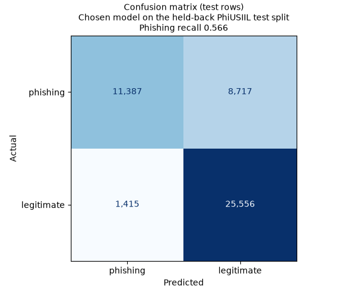
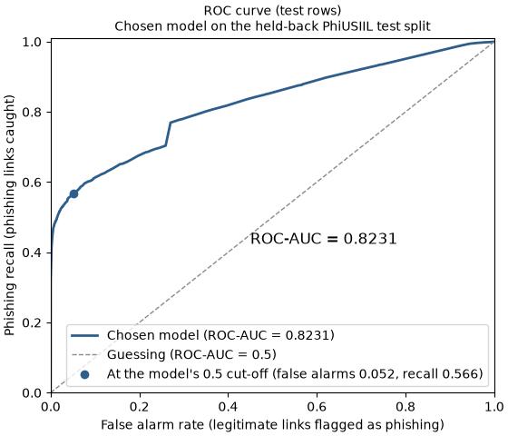

# Evaluation report: the chosen model on the test split

**In-dataset test results on PhiUSIIL, not real-world accuracy.** Every number here comes from `ml/reports/evaluation_results.json`, which `uv run python -m evaluation.evaluate` saves. The two charts come from `uv run python -m evaluation.charts`.

## Summary

- The model catches **56.6%** of the phishing links in the test set. That is its phishing recall, and it is the main measure. It misses the other 43.4% (8,717 links).
- When it does flag a link as phishing, it is right 88.9% of the time (precision). It wrongly flags 5.2% of legitimate links (1,415 of 26,971).
- The ROC-AUC is 0.823 and the accuracy is 78.5%.
- The model is not overfit: its training and test scores are close. It slightly underfits: it scores only moderately even on the rows it learned from, and bigger models did not do better, so the hostname features set the limit (see "Over- and underfitting").
- These are the model's raw results at a cut-off of 0.5. The website's risk levels use the agreed cut-offs of 0.20 and 0.60 instead, so what users see is not the same as these numbers.
- These scores are probably still too high for real links (see "Why these scores are likely too high"). There is no outside-links test in this release, so the PhiUSIIL scores are an upper bound on how the model will do in real use.

## What was tested

- **Model:** gradient boosting (scikit-learn's `HistGradientBoostingClassifier`) with the tuned settings: learning rate 0.1, up to 100 trees, 15 leaves, at least 100 rows per leaf.
  - It uses the 8 final hostname features: `HostnameLength`, `IsDomainIP`, `TLDLength`, `NoOfSubDomain`, `LetterRatioInHostname`, `NoOfDigitsInHostname`, `DigitRatioInHostname` and `NoOfSpecialCharsInHostname`.
  - The saved model takes the ten scaled hostname features and keeps these 8 itself, the same way the backend will use it.
  - It was fitted on all 188,295 training rows.
- **Which model is chosen:** on 9 November 2026 Nic, the Product Owner, confirmed gradient boosting, picked by ROC-AUC, as agreed at sprint planning. This is recorded in [ADR 0004](../../docs/adr/0004-explanation-method.md). The model comparison report (`ml/reports/model_comparison.md`) still names balanced logistic regression, from its recall-first rule.
- **Test set:** the held-back part of the one shared split.
  - The split groups rows by cleaned hostname and keeps the phishing share the same in both sets.
  - The test set has 47,075 links: 20,104 phishing (42.7%) and 26,971 legitimate (57.3%).
  - It was not used for training, choosing features, fitting the scaler or tuning. This was its one use, on this one model.
  - Before scoring, the script checked that no cleaned hostname is in both the training and the test set (0 shared). It also checked that the split was made from the same cleaned data.
- **Positive class:** phishing. The raw dataset has the labels the other way round, so cleaning flips them and 1 = phishing.
- **Cut-off:** a link counts as phishing when the model's phishing score is above 0.5, the model's own default. So these are the model's raw results. The website's risk levels use the two cut-offs the team agreed separately, 0.20 and 0.60 (below 0.20 is Safe, 0.60 and above is High risk). What a user sees is therefore not the same as these numbers.

## Results

| Measure | Test set | Training set | Cross-validation during tuning |
|---|---|---|---|
| **Phishing recall (main measure)** | **0.566** | 0.616 | 0.605 ± 0.014 |
| Precision | 0.889 | | 0.903 ± 0.005 |
| F1 | 0.692 | 0.732 | 0.725 ± 0.009 |
| ROC-AUC | 0.823 | | 0.835 ± 0.003 |
| Accuracy | 0.785 | | 0.804 ± 0.005 |
| False alarm rate (legitimate links flagged) | 0.052 | | |

The cross-validation column is copied from the tuning report ([`ml/reports/tuning.md`](tuning.md)), for comparison only.

**Why phishing recall is the main measure:** a phishing link we miss is the costly mistake. The user is told nothing is wrong and may enter their bank details. A false alarm on a real link is annoying, but it is not dangerous.

### Confusion matrix



- Each row is the real class, and each column is what the model said.
- Of the 20,104 phishing links, 11,387 were caught and 8,717 were missed. 11,387 / 20,104 = 0.566, the recall above.
- Of the 26,971 legitimate links, 25,556 were passed and 1,415 were flagged by mistake. 1,415 / 26,971 = 0.052, the false alarm rate.

### ROC curve



- The curve shows how many phishing links the model catches (up the side) against how many legitimate links it wrongly flags (along the bottom), as the cut-off moves.
- The dot is the model's own 0.5 cut-off.
- The area under the curve is 0.823. Guessing would give 0.5, and a perfect model would give 1.
- The curve climbs steeply at the start, but then it flattens. Moving the cut-off down catches more phishing, but false alarms rise quickly. To reach a recall of about 0.77, false alarms go from about 5% to about 27% of legitimate links, more than five times as many.
- Choosing that trade-off is for the risk-level cut-offs, not for this report.

## Over- and underfitting

- The training recall is 0.616 against 0.566 on the test set, and the training F1 is 0.732 against 0.692.
- Two checks were run, and they use different measures:
  - **This evaluation** compares training and test recall and F1, with the model comparison's limits: a gap of more than 0.05 means overfitting, and a training F1 under 0.70 means underfitting. By those limits it is neither. The recall gap of 0.0495 is right at the limit, and the training F1 of 0.732 is only just above 0.70.
  - **Nic's 10-fold cross-validation check** ([Overfitting and underfitting check (Nic)](https://alprojectcs3.atlassian.net/wiki/spaces/AGILE/pages/51249161)) compares training and validation accuracy. Both are about 80%, with a 0.4% gap, and bigger models did not do better.
- **What we stand by:** the model is **not overfit**, and it **slightly underfits**. Both checks agree there is no overfitting. Scores that stay moderate even on the training rows, and the fact that bigger models do no better, both point to the 8 hostname features as the limit, not the model's settings. The 0.70 F1 line in our rule is only a rough floor, so passing it does not rule out mild underfitting.
- The fall from cross-validation (0.605) to the test set (0.566) is more likely because the test hosts are a bit different from the training hosts, which is what a host-grouped split is meant to show.

## What the model gets wrong

- **Missed phishing (8,717 links):** the model only sees the hostname. A phishing link on an ordinary-looking hostname, with a normal length, few digits and no odd characters, looks the same to it as a real site. Many phishing links are hosted on shared platforms, and the hostname alone can't tell those apart from the platform's real users.
- **False alarms (1,415 links):** legitimate sites with long or unusual hostnames, such as many subdomains, digits or hyphens, look like phishing to it.
- These two failure types come from the confusion-matrix counts. We did not look at individual test links, because the test set is used once and opening dataset links is against our safety rules.

## Why these scores are likely too high

- **Known leakage in PhiUSIIL:**
  - Our research found that every legitimate link in the dataset follows one template, `https://www.<domain>` with no path. A simple pattern rule with nothing learned scores over 99% accuracy on the dataset because of this (`docs/research/phiusiil-features.md`, section 4).
  - We cut the features down to the hostname to get away from that template. But the legitimate links are still mostly big sites' front pages, so the test scores are likely higher than on everyday links.
- **Shared parent domains:**
  - The split keeps each host in one set, but not each parent domain.
  - The model comparison counted that 23.5% of test links, and 51.8% of test phishing links, share a parent domain (such as `web.app`) with training links.
  - So part of the test set is easier than truly new links would be.
- **No outside test:** there is no outside-links test in this release. That means the PhiUSIIL scores are an **upper bound** on real-world performance, not an estimate of it.

## Limitations and next steps

- Test the model on links that do not come from PhiUSIIL, such as recent phishing feeds and ordinary legitimate links with paths, before trusting these numbers.
- Regroup the split by parent domain, so that shared platforms can't sit in both sets. This is already noted as separate work in the model comparison.
- Set the website's risk-level cut-offs with recall in mind, using the training data, never the test set.
- Add features beyond the hostname only if they can be worked out the same way at scan time and do not bring the template leakage back.

## How to reproduce

From `ml/`, with the dataset, feature set, split, scaler and saved model in place (see `ml/README.md`):

```bash
uv run python -m evaluation.evaluate
uv run python -m evaluation.charts
```

Running the evaluation twice gave a byte-for-byte identical results file.
