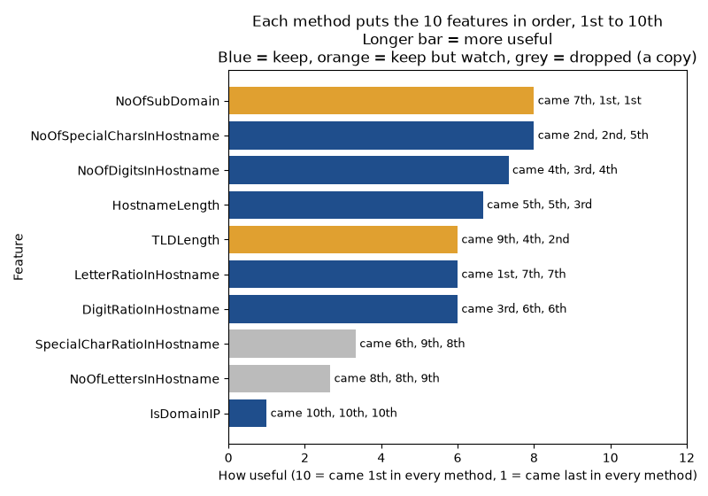

# The final feature list

The model trains on these 8 of the ten hostname features. Each method put the ten features in order, 1st to 10th, on the training split only.

## Kept

| Feature | Places (mutual information, forest, forest on held-out hosts) | Why it stays |
|---|---|---|
| `HostnameLength` | 5th, 5th, 3rd | Long hosts are a common phishing trick. It came higher than NoOfLettersInHostname, so it is the one of that pair that stays. |
| `IsDomainIP` | 10th, 10th, 10th | It came last in every method because only 510 of 188,295 training links use an IP address. It stays because a link that uses an IP address is a clear warning the result card can show. |
| `TLDLength` | 9th, 4th, 2nd | Kept, but watched. Common endings like .com are typical of the big sites' front pages that make up the legitimate links. |
| `NoOfSubDomain` | 7th, 1st, 1st | Kept, but watched. Few subdomains is typical of the big sites' front pages that make up the legitimate links. |
| `LetterRatioInHostname` | 1st, 7th, 7th | It came 1st by mutual information. It shows how much of the host is letters, which no count shows. |
| `NoOfDigitsInHostname` | 4th, 3rd, 4th | It came 3rd or 4th in all three methods, so the methods agree it helps. |
| `DigitRatioInHostname` | 3rd, 6th, 6th | It shows how much of the host is digits, which the count alone does not. It came 3rd by mutual information. |
| `NoOfSpecialCharsInHostname` | 2nd, 2nd, 5th | Many dots and hyphens are a common phishing sign. It came 2nd in two methods. |

## Dropped

PCA showed that two of the ten features are exact copies of others. Each one also came lower than the features it copies.

| Feature | Places | Why it goes |
|---|---|---|
| `NoOfLettersInHostname` | 8th, 8th, 9th | It is HostnameLength minus the digits minus the special characters, so it adds nothing new. |
| `SpecialCharRatioInHostname` | 6th, 9th, 8th | The three ratios always add up to 1, so it is 1 minus the letter and digit ratios. |

## Where the methods disagree

- `NoOfSubDomain` and `TLDLength` come low by mutual information but high for the forest. Mutual information scores each feature on its own. The forest uses them together with the other features. On held-out training hosts, shuffling either one costs the forest the most accuracy. Both stay.
- `LetterRatioInHostname` comes 1st by mutual information but lower for the forest. On its own it separates the classes well. The forest gets much of the same signal from the counts. It stays.
- `NoOfSpecialCharsInHostname` comes higher in the forest's built-in importance than on held-out hosts. The built-in importance favours features with many different values. It stays.
- PCA weight is not usefulness. PCA never looks at the label. `IsDomainIP` weighs a lot on two PCA components but is rare. `NoOfSubDomain` weighs little in PCA but leads the forest. So PCA was only used to find the copies.

## How it follows the team's decisions

- Every kept feature is one of the ten hostname features in the template-bias decision record (`docs/adr/0002-hostname-features-for-template-bias.md`). None is a URL-wide or page feature. None is a precomputed dataset column.
- The leakage recheck found no single feature over the 95% line. So none of the eight gives the answer away on its own.
- Two kept features are marked to watch. The legitimate links in the dataset are mostly front pages of big sites. Part of these features' strength may come from that, not from phishing itself:
  - `NoOfSubDomain`: Few subdomains is typical of the big sites' front pages that make up the legitimate links.
  - `TLDLength`: Common endings like .com are typical of the big sites' front pages that make up the legitimate links.

## All four rankings

| Feature | Mutual information | Forest (built-in) | Forest (held-out hosts) | PCA weight |
|---|---|---|---|---|
| `NoOfSpecialCharsInHostname` | 2nd | 2nd | 5th | 5th |
| `HostnameLength` | 5th | 5th | 3rd | 3rd |
| `DigitRatioInHostname` | 3rd | 6th | 6th | 1st |
| `NoOfSubDomain` | 7th | 1st | 1st | 8th |
| `LetterRatioInHostname` | 1st | 7th | 7th | 2nd |
| `NoOfDigitsInHostname` | 4th | 3rd | 4th | 6th |
| `TLDLength` | 9th | 4th | 2nd | 10th |
| `SpecialCharRatioInHostname` | 6th | 9th | 8th | 4th |
| `NoOfLettersInHostname` | 8th | 8th | 9th | 9th |
| `IsDomainIP` | 10th | 10th | 10th | 7th |

Made by `uv run python -m ranking.final_list`.
