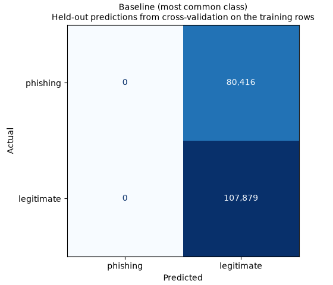
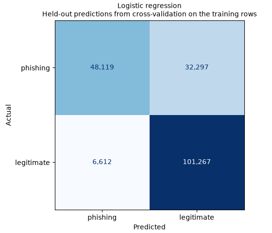
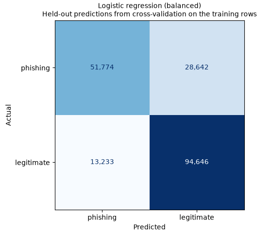
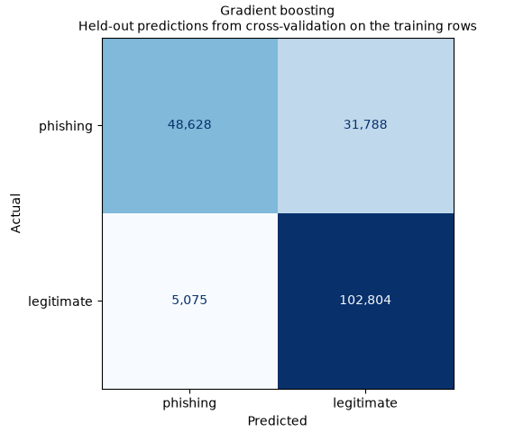

# Model comparison

**In-dataset cross-validation results, not real-world accuracy.**

## How it was made

- 188,295 training rows. They are the training part of the shared host-grouped split. The test rows were not used.
- Stratified 5-fold cross-validation, grouped by host, with seed 0. No host is in two folds.
- Inside each fold the scaler and the model are fitted together on the fold's training rows only.
- The 8 final features: `HostnameLength`, `IsDomainIP`, `TLDLength`, `NoOfSubDomain`, `LetterRatioInHostname`, `NoOfDigitsInHostname`, `DigitRatioInHostname`, `NoOfSpecialCharsInHostname`.
- Phishing (label 1) is the positive class. Each score is the mean over the folds ± the standard deviation.
- The training columns are the mean score on the rows each fold's model trained on.

## Cross-validation scores

| Model | Phishing recall | Recall on training rows | Precision | F1 | F1 on training rows | ROC-AUC | Accuracy |
|---|---|---|---|---|---|---|---|
| Baseline (most common class) | 0.000 ± 0.000 | 0.000 | 0.000 ± 0.000 | 0.000 ± 0.000 | 0.000 | 0.500 ± 0.000 | 0.573 ± 0.000 |
| Logistic regression | 0.598 ± 0.019 | 0.599 | 0.879 ± 0.002 | 0.712 ± 0.013 | 0.712 | 0.785 ± 0.002 | 0.793 ± 0.007 |
| Logistic regression (balanced) | 0.644 ± 0.012 | 0.644 | 0.797 ± 0.011 | 0.712 ± 0.008 | 0.712 | 0.785 ± 0.002 | 0.778 ± 0.006 |
| Random forest | 0.604 ± 0.014 | 0.618 | 0.906 ± 0.005 | 0.725 ± 0.009 | 0.737 | 0.833 ± 0.003 | 0.804 ± 0.005 |
| Gradient boosting | 0.605 ± 0.015 | 0.616 | 0.906 ± 0.004 | 0.725 ± 0.010 | 0.734 | 0.836 ± 0.003 | 0.804 ± 0.005 |

Phishing recall is the main measure. It is the share of phishing links the model catches. Accuracy comes last, because the dataset's legitimate links are mostly big sites' front pages, which makes it look higher than it is.

## Chosen model: Logistic regression (balanced)

It has the highest mean phishing recall, 0.644. The next best is Gradient boosting at 0.605.

By the team's rule the highest mean phishing recall wins. If models are within 0.01 on recall, the highest F1 wins. If they are also within 0.01 on F1, the simpler model wins. The baseline is not a candidate.

## Over- and underfitting

No model looks overfit. Every training score is within 0.05 of the cross-validation score. No model looks underfit. Every training F1 is 0.70 or more. The baseline is left out, because it always predicts the same class.

## Class balance and class weights

The training part has 80,416 phishing (42.7%) and 107,879 legitimate (57.3%) links. Every fold keeps about that share. No rows are resampled. On logistic regression, class weights moved mean phishing recall from 0.598 to 0.644 and precision from 0.879 to 0.797. The chosen model uses class weights (class_weight="balanced"), because with them it came first by the rule above.

## Confusion matrices

Each matrix adds up the 5 held-out folds. Every training row is predicted once, by the fold's model that did not train on it. Rows are the actual class and columns the predicted class.

Made by `uv run python -m training.model_comparison`.
