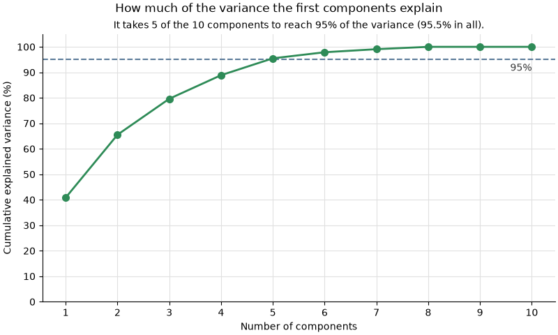

# PCA on the ten hostname features

## How it was made

- Training rows: 188,295. Test rows are dropped before anything is fitted.
- The rows are scaled with the saved scaler (`ml/models/scaler.joblib`). It is only used to transform. It is never fitted again.
- PCA keeps all 10 components. It uses scikit-learn's full solver with seed 0, so a second run gives the same result.

## Explained variance

| Component | Variance % | Cumulative % |
|---|---|---|
| PC1 | 40.85 | 40.85 |
| PC2 | 24.66 | 65.51 |
| PC3 | 14.11 | 79.62 |
| PC4 | 9.25 | 88.87 |
| PC5 | 6.62 | 95.49 |
| PC6 | 2.38 | 97.87 |
| PC7 | 1.20 | 99.08 |
| PC8 | 0.92 | 100.00 |
| PC9 | 0.00 | 100.00 |
| PC10 | 0.00 | 100.00 |

**Takeaway:** It takes 5 of the 10 components to reach 95% of the variance (95.5% in all).

## Loadings on the main components

The main components are the fewest that reach 95% of the variance. Here that is PC1 to PC5.
Each cell is a feature's weight on a component. The sign only gives the direction.
On each component the 2 features with the largest weight, ignoring the sign, are in bold.
The last column lists the components a feature is marked on.

| Feature | PC1 | PC2 | PC3 | PC4 | PC5 | Marked on |
|---|---|---|---|---|---|---|
| `HostnameLength` | 0.35 | **0.43** | -0.08 | 0.18 | -0.03 | PC2 |
| `IsDomainIP` | 0.13 | -0.30 | -0.18 | **0.66** | **0.62** | PC4, PC5 |
| `TLDLength` | -0.05 | 0.28 | -0.36 | **-0.59** | **0.66** | PC4, PC5 |
| `NoOfSubDomain` | 0.37 | 0.17 | 0.37 | -0.06 | 0.03 | - |
| `NoOfLettersInHostname` | 0.22 | **0.53** | -0.02 | 0.28 | 0.03 | PC2 |
| `LetterRatioInHostname` | -0.39 | 0.36 | 0.14 | 0.15 | 0.02 | - |
| `NoOfDigitsInHostname` | **0.41** | -0.07 | -0.34 | -0.14 | -0.27 | PC1 |
| `DigitRatioInHostname` | 0.37 | -0.27 | **-0.39** | -0.07 | -0.13 | PC3 |
| `NoOfSpecialCharsInHostname` | **0.42** | 0.13 | 0.31 | -0.07 | 0.16 | PC1 |
| `SpecialCharRatioInHostname` | 0.19 | -0.34 | **0.55** | -0.23 | 0.26 | PC3 |

## What this means

- PCA ignores the label. The weights show how the features overlap, not which ones find phishing.
  They are a guide for the final feature list, not the decision.
- The components are never used as model inputs. The model keeps the real features.
- No cross-validation happens here. Any later cross-validation puts the scaler and PCA in one scikit-learn Pipeline.
  That Pipeline is fitted on each fold's training part only.

Made by `uv run python -m ranking.pca`.
